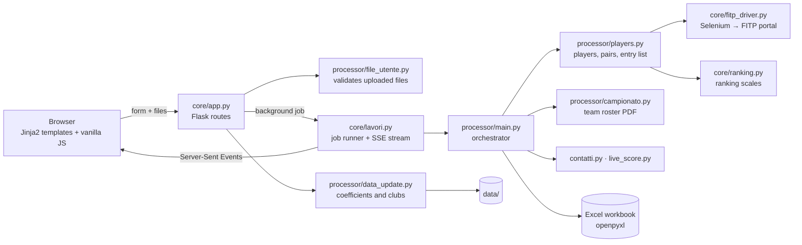

# T.A.S.K — Tennis Automation System Kit for GA

A local web app that automates the pre-tournament paperwork of an Italian tennis and beach-tennis referee/Supervisor (*Giudice Arbitro*, **GA**) working with FITP (Italian Tennis and Padel Federation) data not official.

Upload the player list exported from downloaded from the official italian federal portal for officials, watch the checks run live, and download a formatted Excel workbook ready for the tournament.

> The user interface and the code comments are in Italian: the app is built for Italian referees since it works only with the native italian's files.

---

## Why

Before every tournament a GA receives the entry list from **SGAT** (FITP's management system) and has to:

- open each player's membership card on the FITP portal and check that the **medical certificate** covers the tournament dates (stated from the italian law for sport), and the **citizenship** if required by the factsheet;
- assign each player's club (payer per player) to its **province and region** in tournaments where the seeding is made on their regionality, high time consuming for tournaments with high number of registred players;
- rank players and pairs for the draw (FITP ranking values, beach-tennis **coefficients**, doubles **pair strength**);
- prepare contacts, fees and the files for Live Score and scheduling;
- for team championships, compare the official roster PDF with the players actually registered.

By hand this takes hours and is error-prone. T.A.S.K reduces it to: **upload → live progress → download** reducing human errors.

## Features

**Tennis and beach-tennis tournaments, singles and doubles**
- *Players* sheet with a clickable membership link, medical-certificate check against the tournament dates and citizenship check (Selenium on the FITP portal), club → province / region.
- Doubles: pairs read from the SGAT column `Numero Squadra`. The pair value is the sum of the two FITP ranking values, with separate scales for tennis and beach tennis (`core/ranking.py`).
- Beach tennis: FITP coefficients are assigned and the official Entry List template is filled in (singles or doubles).
- Optional extras: a contacts sheet with a pre-written WhatsApp message and the entry fee, a Live Score CSV, and scheduling sheets.

**Team championship (*campionato a squadre*)**
- Reads the FITP roster PDF (pdfplumber) and offers home and away teams in dropdowns.
- Compares the roster with the SGAT file (home and away sheets) and checks every membership.
- A ready-made Excel template for the SGAT file can be downloaded from the page.

**Reference data kept up to date from the app**
- *Beach coefficients*:
  - upload the FITP ranking PDFs (men + women, merged or separate);
  - they are parsed, validated and replace `coeff_beach.csv` atomically;
  - the previous version is archived.
- *Clubs*:
  - clubs change names often, so after each run the clubs missing from `circolo_regioni.csv` are listed;
  - the user downloads an Excel sheet with a province drop-down, fills it and re-uploads it;
  - the rows are **appended** to the CSV, and the existing rows are never touched.

**Built for non-technical users**
- Zero-terminal start: double-click a launcher (macOS / Windows).
- Guided forms (radio buttons, date pickers, drop-downs): the submit button is enabled only when everything is filled in.
- Live progress with **Server-Sent Events**, so long Selenium runs never time out; reloading the page does not lose the progress.
- Every error and warning has a code (`Err xx` blocks, `Att. xx` warns) documented in [`codici_errori.csv`](codici_errori.csv), with its cause and a *what to do* hint that is shown in the UI.
- There are two kinds of errors:
  - *user-data errors* (wrong file, missing column…) bring the user back to the form with a message;
  - *program errors* stop with a full traceback on purpose, so they are never hidden.

## Architecture



## Project structure

```
├── avvia.py                      launcher (stdlib only): venv, dependencies, port, browser
├── Start TASK.command    double-click start on macOS
├── Start Task.bat        double-click start on Windows
├── requirements.txt
├── codici_errori.csv             error / warning catalogue (cause + what to do)
├── core/
│   ├── app.py                    Flask app: routes, error handling, downloads
│   ├── lavori.py                 background jobs + Server-Sent Events
│   ├── errori.py                 user-error type, lookup in codici_errori.csv
│   ├── conf.py                   paths and constants
│   ├── fitp_driver.py            Selenium driver for the FITP membership portal
│   ├── ranking.py                FITP ranking → numeric scales (tennis / beach)
│   ├── normalize.py              normalisation of names, rankings, phone numbers
│   ├── excel_sheets.py           copy sheets from Excel templates
│   └── excel_style.py            Excel formatting
├── processor/
│   ├── main.py                   orchestrates a tournament / championship run
│   ├── players.py                players, clubs, pairs, entry list
│   ├── campionato.py             team-championship roster PDF parsing and checks
│   ├── contatti.py               contacts sheet (WhatsApp message, fees)
│   ├── live_score.py             Live Score CSV
│   ├── file_utente.py            robust reading and validation of uploaded Excel files
│   └── data_update.py            coefficient update from PDFs, club append
├── templates/                    Jinja2 pages (home, tennis, beach, championship, progress, download)
├── static/                       app.js, style.css
├── data/                         reference data (see below)
└── temp/                         legacy HTML pages from the pre-Flask version (not used)
```

## Getting started

### End users
Requirements: **Python 3.10+**, **Google Chrome**, an internet connection (for the first start and for the FITP checks).

- **macOS**: double-click `Start TASK.command`. The first time, macOS may block it: right-click → *Open* → *Open*.
- **Windows**: double-click `Start TASK.bat`.

The launcher checks the Python version, creates a `.venv`, and installs the dependencies (again, automatically, when `requirements.txt` changes). If the app is already running, it only reopens the browser; otherwise it starts it on port 5050 (or the next free one). To quit, close the terminal window.

### Developers
```bash
python3 -m venv .venv && source .venv/bin/activate
pip install -r requirements.txt
TASK_DEBUG=1 python3 core/app.py        # http://127.0.0.1:5050
```

| Variable | Effect |
|---|---|
| `TASK_DEBUG=1` | Flask debugger and auto-reload; full error pages; lists error codes used in the code but missing from `codici_errori.csv` |
| `TASK_PORTA=5060` | port to listen on (set by the launcher when 5050 is busy) |

## Data files (`data/`)

| File | Content | How it is updated |
|---|---|---|
| `circolo_regioni.csv` | club → province → region (`;`-separated) | append from the app (clubs not found in a run) | (not included in this repo for GDPR policy)
| `coeff_beach.csv` | FITP beach-tennis rankings and coefficients (men + women) | from the FITP ranking PDFs, beach page |
| `mod_el.xlsx` | Entry List templates (beach singles / doubles) | by hand |
| `mod_prog.xlsx` | scheduling sheet templates | by hand |
| `aggiornamenti.json`, `archivio/` | update log and archived previous versions | generated (`archivio/` is not committed) |

## AI assistance disclosure

This project was developed with **Claude (Anthropic) model: OPUS 5.5 Coworking** as an AI coding assistant.

- The author designed the tool and wrote the original processing pipeline.
- Claude built most of the web layer, and refactored and fixed parts of the original scripts.

### Share of AI-generated lines, by language

| Language | Files | Lines* | AI-generated | Author-written | AI, code only** |
|---|---:|---:|---:|---:|---:|
| Python | 17 | 3,054 | **56%** | 44% | 53% |
| HTML (Jinja2 templates) | 11 | 870 | **98%** | 2% | 99% |
| CSS | 1 | 516 | **100%** | 0% | 100% |
| JavaScript | 1 | 314 | **100%** | 0% | 100% |
| Shell / Batch (launchers) | 2 | 44 | **100%** | 0% | 100% |
| **Total** | 32 | 4,798 | **71%** | 29% | 71% |

\* non-blank lines, comments included  ·  \** comment and docstring lines excluded

The Python figure hides two very different halves:

| Python layer | Files | Lines | AI-generated |
|---|---:|---:|---:|
| Domain logic: processing, FITP rules, Selenium driver, Excel output (`main`, `players`, `campionato`, `contatti`, `live_score`, `ranking`, `normalize`, `excel_*`, `fitp_driver`, `conf`) | 11 | 1,694 | **21%** |
| Web app & infrastructure: Flask app, jobs/SSE, error system, file validation, data updates, launcher | 6 | 1,360 | **99%** |

### How the numbers were measured
- **Baseline**: three sources of author-written code:
  - the author's code as it was on 25 Sep 2026, before the AI-assisted work;
  - the author's first draft of `data_update.py`;
  - the author's later edits, recovered from the backups made before each update.
- **Line-level attribution** (a `git blame`-like diff with Python's `difflib`):
  - a non-blank line of the final code counts as *author-written* if it matches, unchanged, a line of an author snapshot;
  - every other line counts as *AI-generated*, including author lines that the AI rewrote.
- **Limits**:
  - author edits made between sessions and not captured in any snapshot are counted as AI, so the AI share is an upper bound;
  - requirements, design decisions and testing on real FITP data do not show up in line counts.
- **Scope**: only the files needed to run the program.
  - Files written from scratch by the AI only for testing (for example a fake FITP driver) are not in the repository and are not counted.
  - Every AI-written file that is counted is used at run time: pages, styles, scripts, job runner, error system, file validation, launchers.
- **Excluded**: data files, `codici_errori.csv`, `requirements.txt`, and the legacy `temp/` pages (142 lines, all author-written, no longer used).

### Who did what
- **Author**
  - the problem domain and the requirements (the referee's workflow);
  - the original pipeline: player processing, the championship PDF parser, the Selenium membership checker, the ranking scales, the Excel output, and tennis / beach doubles;
  - the data rules (for example: *the region is the club's, not the player's residence*);
  - the UX principle of limiting user choices;
  - real FITP data for testing, and the review of every change.
- **AI (Claude)**
  - the Flask web layer, templates, CSS and JavaScript;
  - Server-Sent Events progress, the double-click launcher, validation of uploaded files, and the error-code system;
  - the PDF → CSV coefficient update and the club-append workflow;
  - bug fixes and refactoring in the author's scripts (each one marked `#Comm. Claude:`);
  - end-to-end browser tests (Playwright; not part of this repository).

## Known limitations and roadmap
- Sanction and enablement status (*sanzionato* / *abilitato*) are **not** checked yet.
- The membership checks depend on the structure of the FITP web portal (Selenium): a change on their side needs an update to `core/fitp_driver.py`.
- One processing job runs at a time, and results stay in memory until the app is closed.
- Planned: packaging as a standalone installer.

## Author

**Gagliardi Nicolò** 
- LinkedIn: [profile link] (https://www.linkedin.com/in/nicolo-gagliardi-945873254/)
- Email: [nicolo.gagliardi@studenti.polito.it] (mailto: nicolo.gagliardi@studenti.polito.it)

I am a Master's student in Nuclear Engineering at Politecnico di Torino, focusing on: EGDE Plasma coding, computational fluid dinamics (CFD), finite element analysis, and scientific Python development with Machine Learning methods. Outside the lab, I am a certified Tennis Referee (Giudice Arbitro) for the Italian Tennis and Padel Federation.

I built T.A.S.K. to solve a real-world logistics problem I regularly faced during tournament management: the highly repetitive, error-prone manual validation of hundreds of player memberships. By applying an engineering approach to a bureaucratic bottleneck, this project allowed me to combine my domain knowledge of sports regulations with my Python development skills to build a complete, user-friendly automation pipeline.